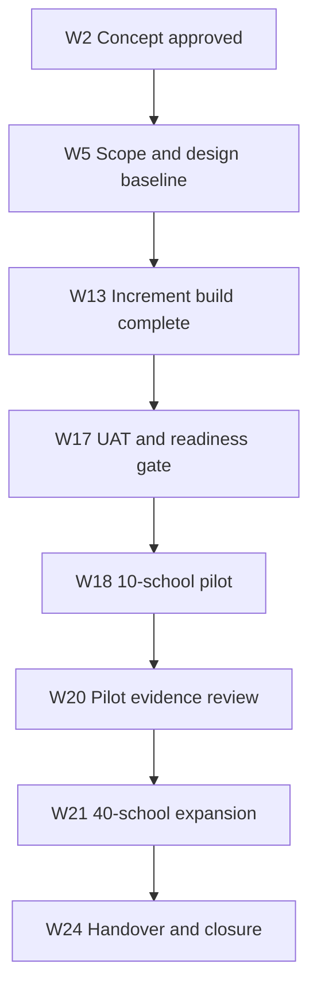

# 03 | Scope statement, WBS and integrated delivery baseline

**Version:** Illustrative v1.0 (W5 baseline). Week numbers are fictional project-relative periods, not dates of real work.

## Product acceptance boundaries

In scope: candidate and school records, enrolment form, examination choices, field validation, duplicate detection, user roles, confirmation, operational export/report, approved data import, school training and support handover. Out of scope: fee collection, refunds, analytics warehouse, native apps and unapproved third-party APIs.

## Work breakdown structure (deliverable oriented)

| WBS | Delivery package | Acceptance evidence |
| --- | --- | --- |
| 1.0 | Discovery and governance | Stakeholder map, charter, signed baseline |
| 2.0 | Business & solution design | Approved workflows, requirements, access design |
| 3.0 | Registration platform | User stories, demonstrable modules, demo acceptance |
| 3.1 | Candidate and school registry | Requirements REQ-01/02 implemented |
| 3.2 | Examination selection and validation | REQ-03/04 verified |
| 3.3 | Confirmation, access, report/export | REQ-05/06/07 verified |
| 4.0 | Transition data and quality | Reconciled imports, system test, UAT gate |
| 5.0 | Change and adoption | Guides, training completion, service documentation |
| 6.0 | Deployment and operations | Pilot, expanded launch, hypercare, operations acceptance |
| 7.0 | Governance and closure | Decision log, status, closure report, benefits owner |

## Integrated sequencing

**Schedule control:** PM maintains dependency paths and updates forecast weekly. Entry into W18 requires W17 approval; W21 depends on pilot evidence and a separate operational gate. Work in the W16 illustrative exception uses W17 available remediation capacity, preserving W18 forecast without changing the baselined end date.

## Milestone gate evidence

| Gate | Required records | Decision authority |
| --- | --- | --- |
| G0 W2 | Business case; sponsor intent | Sponsor |
| G1 W5 | Scope, cost, dependencies, risks, acceptance | Sponsor / Business Owner |
| G2 W13 | Demo acceptance; critical interface evidence | Business Owner / Technical Lead |
| G3 W17 | UAT, defects, access review, migration reconciliation, training readiness | Business Owner + Ops Lead; sponsor decides go/no-go |
| G4 W20 | Pilot incidents, support load, performance and adoption | Sponsor |
| G5 W24 | Service acceptance, documentation, benefits ownership | Business Owner + Ops Lead |

**Baseline adjustments:** any new scope follows change control; baseline dates are not silently rewritten. Detailed [milestones.csv](../registers/milestones.csv).
